<div align="center">

<picture>
  <source media="(prefers-color-scheme: dark) and (min-width: 1012px)" srcset="docs/hero-dark.svg">
  <source media="(prefers-color-scheme: light) and (min-width: 1012px)" srcset="docs/hero-light.svg">
  <source media="(prefers-color-scheme: dark)" srcset="docs/hero-dark-mobile.svg">
  <source media="(prefers-color-scheme: light)" srcset="docs/hero-light-mobile.svg">
  
</picture>

[](https://github.com/Sagargupta16/svg-forge/actions/workflows/ci.yml)


</div>

A Claude Code plugin for designing animated SVGs that look deliberate and render everywhere they are shown: self-contained files for any web page, app, docs site or GitHub README, poster PNGs for slides, email and link previews, and React + Motion scenes for web apps. The header above was made with it; open this page on a phone and it swaps to a layout drawn for that width.

It packages what actually worked (and what broke) while building animated README cards, project cover scenes and diagrams: the rules, the gotchas with their fixes, a generator, and a validator that catches the mistakes that make an SVG silently stop animating.

## Install

```
/plugin marketplace add Sagargupta16/svg-forge
/plugin install svg-forge@svg-forge
```

The generator and validator are plain Python 3.12+ scripts with no dependencies, so they also work without Claude Code.

## What's inside

| Part | Use it for |
| --- | --- |
| [`animated-svg`](skills/animated-svg/SKILL.md) skill | Standalone `.svg` files for pages, apps, docs and READMEs: headers, banners and section headings, stats, streak and project cards, diagrams, loaders, badges, marquees. Covers what GitHub's image proxy allows, a SMIL and CSS cookbook, timing, design, isometric line figures, safe optimization, gotchas and accessibility. |
| [`motion-scene`](skills/motion-scene/SKILL.md) skill | Animated illustrations inside a React app with Motion: cover art, card scenes, mechanism diagrams. Research, build and verify modes, plus a copy-in TypeScript kit. |
| [`svg-audit`](skills/svg-audit/SKILL.md) skill | Ranked findings for an existing SVG or scene: render-target safety, accessibility, motion quality, weight. Reports first, fixes on request. |
| [`svg-designer`](agents/svg-designer.md) agent | End to end: studies the subject, storyboards, builds, validates and iterates until it reads at the size it is shown. |
| [`forge.py`](skills/animated-svg/scripts/forge.py) | Generator: 23 kinds ([the list](skills/animated-svg/references/kinds.md)) at any size, in 15 theme presets or a theme built from one brand color, with 5 timing presets and 11 loaders. Text kinds also draw a 320 px phone layout (`--device both`). Every color is tuned to WCAG contrast; output is deterministic and escaped. |
| [`pack.py`](skills/animated-svg/scripts/pack.py) | One JSON file in, a whole README's cards out: every card in one theme and accent, plus `snippet.md` with the markup in order. Starter packs for a [profile](skills/animated-svg/assets/packs/profile.json) and a [project](skills/animated-svg/assets/packs/project.json). |
| [`themes.py`](skills/animated-svg/scripts/themes.py) and [`sizes.py`](skills/animated-svg/scripts/sizes.py) | GitHub, Nord, Dracula, Catppuccin, Tokyo Night, Gruvbox, Solarized, One Dark, high-contrast and transparent themes, `auto:<hex>` brand themes and palette files; 15 size presets from `favicon-32` to `youtube-banner`. |
| [`validate_svg.py`](skills/animated-svg/scripts/validate_svg.py) | Validator: rules SV001 to SV024 for GitHub safety, accessibility (including WCAG contrast on both GitHub themes), ids, size and animation sanity. |
| [`frames.py`](skills/animated-svg/scripts/frames.py) | Renders an animation's timeline as a PNG contact sheet (headless Chrome, Edge or Chromium), so an agent can see the timing, overlaps and loop seam. `--poster` writes one clean PNG of the finished frame for slides, email and link previews. |
| [`optimize_svg.py`](skills/animated-svg/scripts/optimize_svg.py) | An animation-safe minifier that checks its output before writing, plus an [SVGO config](skills/animated-svg/assets/svgo.config.mjs) that keeps animations intact. |

Ask Claude for "an animated header for my README" or "a cover scene that shows how this tool works", or run the scripts directly:

```bash
python skills/animated-svg/scripts/forge.py --kind flow --timing long \
  --data "push -> build -> test -> deploy" --theme both --out pipeline.svg
python skills/animated-svg/scripts/forge.py --kind ring --theme nord --size og \
  --data examples/data/goals.json --out goals.svg
python skills/animated-svg/scripts/validate_svg.py goals.svg --strict-contrast
python skills/animated-svg/scripts/frames.py goals.svg
python skills/animated-svg/scripts/pack.py skills/animated-svg/assets/packs/profile.json --out-dir assets/cards
```

## Where it runs

Anywhere an image shows. Browsers play SMIL and CSS animation inside ``, `<picture>` and CSS backgrounds and block script there, so one forge file works on a landing page, in a React or Vue app, on a docs site, on npm and PyPI, and in a README. Inline it when you want hover or the page's own theme switch. Where a surface takes no SVG, `frames.py --poster` gives a PNG of the finished frame: link previews, slides, email. Each surface with its sources: [where-it-runs.md](skills/animated-svg/references/where-it-runs.md).

## Phone and desktop

An 840 px card in a phone's README column, about 308 px wide, shows at about 0.37x, so its labels turn to texture. `--device both` writes a second file drawn 320 px wide with no text under 10.5 px: tiles in two columns, flows and timelines top to bottom, calendars on the last 26 weeks, long labels wrapped. The printed `<picture>` shows the phone file and swaps in the desktop one from 1012 px, GitHub's large breakpoint, or from your own page's width with `--breakpoint`; with `--theme both` that is four files and four sources, like the header above. Details: [github-readme.md](skills/animated-svg/references/github-readme.md) section 3b.

## Sizes and themes

`--size` takes a preset (`readme`, `card`, `og`, `linkedin-banner`, `square`, `story`, `icon-128` and more), a width or `WxH`, for every kind. Thirteen kinds lay out at that canvas; the other ten scale their layout in without distortion ([themes-and-sizes.md](skills/animated-svg/references/themes-and-sizes.md)). `--theme` takes `dark`, `light` or `both` (GitHub's pair with a `<picture>` snippet), any preset, `auto:#ff6b6b` for a brand color, or a palette JSON; `--mode both` writes the dark and light pair for any family that has one. Text always reaches 4.5:1 and marks 3:1, and any color that had to move is reported.

## Timing presets

| Preset | Length | For |
| --- | --- | --- |
| `micro` | 120 to 300 ms, once | hover, press and toggle feedback |
| `short` | 0.4 to 1.2 s, once | staggered entrances that hold their final frame |
| `medium` | 3 to 6 s loop | mechanism scenes, pulses, packets on a path (default) |
| `long` | 8 to 20 s loop | storyboards of 3 to 6 beats on one shared clock |
| `ambient` | set by speed (px/s) | slow drift and marquees |

Entrances are poster-safe: an SVG's static attributes hold the finished frame, so link previews and PNG exports never show blank tiles. Motion is on by default; `--reduced-motion respect` adds an opt-in `prefers-reduced-motion` block for CSS animations.

## Gallery

Every example is generated and reproducible byte for byte; the commands are in [examples/README.md](examples/README.md).

| | |
| --- | --- |
|  |  |
| `flow`, long: 8-beat storyboard with a return arc | `tiles`, medium: spotlight cycling the tiles |
|  |  |
| `chart`, medium: draws, holds, fades, repeats | `marquee`, ambient: two rows in opposite directions |
|  | 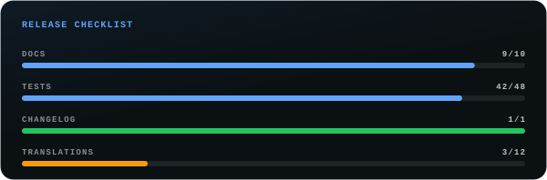 |
| `typing`, medium: terminal lines | `bars`, long: value and max labels |
| 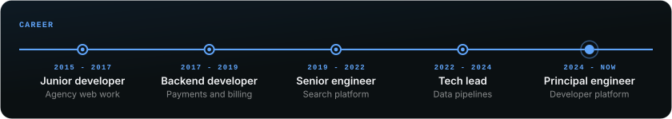 |  |
| `timeline`, long: the rail draws in, the current role pulses | `calendar`, short: quartile levels, so one busy day does not flatten the rest |
|  |  |
| `ring`, short: progress rings with value and max labels | `logos`, short: inline SVG logos, a PNG and text pills |
|  | 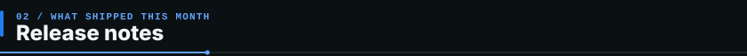 |
| `banner`, long: wave layers drift under lines that take turns | `heading`, medium: numbered section header, the rule draws in |
|  |  |
| `stats`, short: six glyph rows and a grade ring | `streak`, short: total, current and longest streak |
|  | 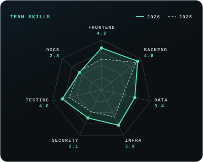 |
| `breakdown`, short: stacked bar and legend (or donut, pie) | `radar`, medium: the polygon grows over a compare series |
|  |  |
| `card`, medium: status, summary, tags, stars and forks | `quote`, long: three quotes take turns |
|  |  |
| `skyline`, short: the year as an isometric line city | the streak card's phone file: stacked, 320 px, no text under 10.5 px |

Eleven loaders, each one `--variant`:

<p align="center">
<picture></picture> <picture></picture> <picture></picture> <picture></picture> <picture>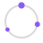</picture> <picture></picture> <picture></picture> <picture></picture> <picture></picture> <picture></picture> <picture>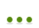</picture>
</p>

Starter files for every kind live in [skills/animated-svg/assets/templates/](skills/animated-svg/assets/templates/). `python scripts/preview.py` builds a local gallery of everything on GitHub's dark and light backgrounds.

## What GitHub allows, in one paragraph

GitHub sanitizes inline `<svg>` in Markdown, so an SVG animates only when it is referenced as an image. Through the image proxy, inline `<style>`, CSS `@keyframes`, SMIL and `data:` URIs work; scripts, `<foreignObject>`, external fonts and external images do not. `prefers-color-scheme` inside the file follows the OS rather than GitHub's theme and fails on WebKit, so ship a `<picture>` pair (`forge.py --theme both` prints the snippet). Sources and the rest of the rules are in [github-readme.md](skills/animated-svg/references/github-readme.md).

## Development

```bash
python scripts/check.py
python -m pytest -q
ruff check .
ruff format --check .
npx -y @sagargupta1610/skillcheck@0.2.5 lint skills
```

Evals: `evals/` holds a `claude plugin eval` suite (13 cases). Run `claude plugin eval . --scaffold --allow-tools Write Edit`; add `Bash` on Linux, macOS or WSL2.

See [CONTRIBUTING.md](CONTRIBUTING.md) for adding a kind (with its phone layout), a validator rule or skill content, and [SECURITY.md](SECURITY.md) for reporting issues.

## License

[MIT](LICENSE)
