<div align="center">

<picture>
  <source media="(prefers-color-scheme: dark)" srcset="docs/hero-dark.svg">
  <source media="(prefers-color-scheme: light)" srcset="docs/hero-light.svg">
  
</picture>

[](https://github.com/Sagargupta16/svg-forge/actions/workflows/ci.yml)


</div>

A Claude Code plugin for designing animated SVGs that look deliberate and render everywhere they are shown: self-contained files for GitHub READMEs and `` tags, and React + Motion scenes for web apps. The header above was made with it.

It packages what actually worked (and what broke) while building animated README cards, project cover scenes and diagrams: the rules, the gotchas with their fixes, a generator, and a validator that catches the mistakes that make an SVG silently stop animating.

## Install

```
/plugin marketplace add Sagargupta16/svg-forge
/plugin install svg-forge@svg-forge
```

The generator and validator are plain Python 3.12+ scripts with no dependencies, so they also work without Claude Code.

## What's inside

| Part | Use it for |
| --- | --- |
| [`animated-svg`](skills/animated-svg/SKILL.md) skill | Standalone `.svg` files: README headers and stat cards, diagrams, loaders, badges, marquees. Covers what GitHub's image proxy allows, a SMIL and CSS cookbook, timing, design, safe optimization, gotchas and accessibility. |
| [`motion-scene`](skills/motion-scene/SKILL.md) skill | Animated illustrations inside a React app with Motion: cover art, card scenes, mechanism diagrams. Research, build and verify modes, plus a copy-in TypeScript kit. |
| [`svg-audit`](skills/svg-audit/SKILL.md) skill | Ranked findings for an existing SVG or scene: render-target safety, accessibility, motion quality, weight. Reports first, fixes on request. |
| [`svg-designer`](agents/svg-designer.md) agent | End to end: studies the subject, storyboards, builds, validates and iterates until it reads at the size it is shown. |
| [`forge.py`](skills/animated-svg/scripts/forge.py) | Generator: 14 kinds (tiles, hero, marquee, chart, bars, flow, loader, typing, divider, badge, timeline, logos, calendar, ring) at any size, in 15 theme presets or a theme built from one brand color, with 5 timing presets. Every color is tuned to WCAG contrast; output is deterministic and escaped. |
| [`themes.py`](skills/animated-svg/scripts/themes.py) and [`sizes.py`](skills/animated-svg/scripts/sizes.py) | GitHub, Nord, Dracula, Catppuccin, Tokyo Night, Gruvbox, Solarized, One Dark, high-contrast and transparent themes, `auto:<hex>` brand themes and palette files; 15 size presets from `favicon-32` to `youtube-banner`. |
| [`validate_svg.py`](skills/animated-svg/scripts/validate_svg.py) | Validator: rules SV001 to SV023 for GitHub safety, accessibility (including WCAG contrast on both GitHub themes), ids, size and animation sanity. |
| [`frames.py`](skills/animated-svg/scripts/frames.py) | Renders an animation's timeline as a PNG contact sheet (headless Chrome, Edge or Chromium), so an agent can see the timing, overlaps and loop seam. |
| [`optimize_svg.py`](skills/animated-svg/scripts/optimize_svg.py) | An animation-safe minifier that checks its output before writing, plus an [SVGO config](skills/animated-svg/assets/svgo.config.mjs) that keeps animations intact. |

Ask Claude for "an animated header for my README" or "a cover scene that shows how this tool works", or run the scripts directly:

```bash
python skills/animated-svg/scripts/forge.py --kind flow --timing long \
  --data "push -> build -> test -> deploy" --theme both --out pipeline.svg
python skills/animated-svg/scripts/forge.py --kind ring --theme nord --size og \
  --data examples/data/goals.json --out goals.svg
python skills/animated-svg/scripts/validate_svg.py goals.svg --strict-contrast
python skills/animated-svg/scripts/frames.py goals.svg
```

## Sizes and themes

`--size` takes a preset (`readme`, `card`, `og`, `linkedin-banner`, `square`, `story`, `icon-128` and more), a width or `WxH`, for every kind. Timeline, logos, calendar and ring lay out at that canvas; the other kinds scale their layout in without distortion. `--theme` takes `dark`, `light` or `both` (GitHub's pair with a `<picture>` snippet), any preset, `auto:#ff6b6b` for a brand color, or a palette JSON; `--mode both` writes the dark and light pair for any family that has one. Text always reaches 4.5:1 and marks 3:1, and any color that had to move is reported.

## Timing presets

| Preset | Length | For |
| --- | --- | --- |
| `micro` | 120 to 300 ms, once | hover, press and toggle feedback |
| `short` | 0.4 to 1.2 s, once | staggered entrances that hold their final frame |
| `medium` | 3 to 6 s loop | mechanism scenes, pulses, packets on a path (default) |
| `long` | 8 to 20 s loop | storyboards of 3 to 6 beats on one shared clock |
| `ambient` | set by speed (px/s) | slow drift and marquees |

Entrances are poster-safe: an SVG's static attributes hold the finished frame, so link previews and PNG exports never show blank tiles. Motion is on by default; `--reduced-motion respect` adds an opt-in `prefers-reduced-motion` block for CSS animations.

## Gallery

Every example is generated and reproducible byte for byte; the commands are in [examples/README.md](examples/README.md).

| | |
| --- | --- |
|  |  |
| `flow`, long: 8-beat storyboard with a return arc | `tiles`, medium: spotlight cycling the tiles |
|  |  |
| `chart`, medium: draws, holds, fades, repeats | `marquee`, ambient: two rows in opposite directions |
|  |  |
| `typing`, medium: terminal lines | `bars`, long: value and max labels |
|  |  |
| `timeline`, long: the rail draws in, the current role pulses | `calendar`, short: quartile levels, so one busy day does not flatten the rest |
|  |  |
| `ring`, short: progress rings with value and max labels | `logos`, short: inline SVG logos, a PNG and text pills |

Starter files for every kind live in [skills/animated-svg/assets/templates/](skills/animated-svg/assets/templates/). `python scripts/preview.py` builds a local gallery of everything on GitHub's dark and light backgrounds.

## What GitHub allows, in one paragraph

GitHub sanitizes inline `<svg>` in Markdown, so an SVG animates only when it is referenced as an image. Through the image proxy, inline `<style>`, CSS `@keyframes`, SMIL and `data:` URIs work; scripts, `<foreignObject>`, external fonts and external images do not. `prefers-color-scheme` inside the file follows the OS rather than GitHub's theme and fails on WebKit, so ship a `<picture>` pair (`forge.py --theme both` prints the snippet). Sources and the rest of the rules are in [github-readme.md](skills/animated-svg/references/github-readme.md).

## Development

```bash
python scripts/check.py
python -m pytest -q
ruff check .
ruff format --check .
npx -y @sagargupta1610/skillcheck@0.2.5 lint skills
```

Evals: `evals/` holds a `claude plugin eval` suite (12 cases). Run `claude plugin eval . --scaffold --allow-tools Write Edit`; add `Bash` on Linux, macOS or WSL2.

See [CONTRIBUTING.md](CONTRIBUTING.md) for adding a kind, a validator rule or skill content, and [SECURITY.md](SECURITY.md) for reporting issues.

## License

[MIT](LICENSE)
