# Examples

Every file here is generated. `python scripts/preview.py --rebuild` reruns the
commands below from the repository root, and the tests check that each command
still reproduces its file byte for byte. Input data lives in [data/](data/).

Starter files for each kind (dark theme, default timing) are in
[skills/animated-svg/assets/templates/](../skills/animated-svg/assets/templates/).

| kind | preset | preview | command |
| --- | --- | --- | --- |
| hero | long<br>both themes, custom accent |   | `python skills/animated-svg/scripts/forge.py --kind hero --theme both --accent '#a78bfa' --data examples/data/hero.json --out examples/hero-violet.svg` |
| tiles | short<br>staggered entrance that holds |  | `python skills/animated-svg/scripts/forge.py --kind tiles --timing short --accent '#22c55e' --data examples/data/tiles.json --out examples/tiles-once.svg` |
| tiles | medium<br>spotlight cycling the tiles |  | `python skills/animated-svg/scripts/forge.py --kind tiles --timing medium --data examples/data/tiles.json --out examples/tiles-spotlight.svg` |
| flow | long<br>8-beat storyboard with a return arc |  | `python skills/animated-svg/scripts/forge.py --kind flow --timing long --accent '#38bdf8' --data examples/data/pipeline.json --out examples/flow-storyboard.svg` |
| flow | medium<br>fixed node positions, edge labels |  | `python skills/animated-svg/scripts/forge.py --kind flow --accent '#f472b6' --data examples/data/architecture.json --out examples/flow-architecture.svg` |
| flow | long, once<br>storyboard played once, then held |  | `python skills/animated-svg/scripts/forge.py --kind flow --timing long --once --data examples/data/pipeline.json --out examples/flow-once.svg` |
| marquee | ambient<br>two rows in opposite directions at 30 px/s |  | `python skills/animated-svg/scripts/forge.py --kind marquee --speed 30 --accent '#f59e0b' --data examples/data/stack.json --out examples/marquee-rows.svg` |
| chart | medium<br>draws, holds, fades, repeats |  | `python skills/animated-svg/scripts/forge.py --kind chart --timing medium --accent '#34d399' --data examples/data/weekly.json --out examples/chart-loop.svg` |
| chart | short<br>light theme, one-shot |  | `python skills/animated-svg/scripts/forge.py --kind chart --theme light --data examples/data/weekly.json --out examples/chart-light.svg` |
| bars | long<br>value/max labels, long loop | 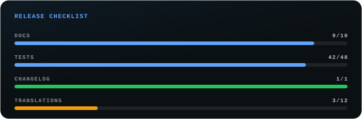 | `python skills/animated-svg/scripts/forge.py --kind bars --timing long --data examples/data/checklist.json --out examples/bars-loop.svg` |
| loader | medium |  | `python skills/animated-svg/scripts/forge.py --kind loader --variant dots --accent '#22c55e' --out examples/loader-dots.svg` |
| loader | short |  | `python skills/animated-svg/scripts/forge.py --kind loader --variant bar --timing short --out examples/loader-bar.svg` |
| loader | ambient<br>slow drift from --speed |  | `python skills/animated-svg/scripts/forge.py --kind loader --timing ambient --accent '#fb7185' --out examples/loader-spinner-ambient.svg` |
| typing | medium<br>opt-in reduced-motion block for the CSS cursor |  | `python skills/animated-svg/scripts/forge.py --kind typing --timing medium --reduced-motion respect --data examples/data/terminal.json --out examples/typing-medium.svg` |
| divider | ambient<br>pulse crossing at 80 px/s |  | `python skills/animated-svg/scripts/forge.py --kind divider --timing ambient --speed 80 --out examples/divider-ambient.svg` |
| badge | medium<br>both themes |   | `python skills/animated-svg/scripts/forge.py --kind badge --theme both --data examples/data/status.json --out examples/badge-status.svg` |
| badge | short<br>one entrance and one shine |  | `python skills/animated-svg/scripts/forge.py --kind badge --timing short --accent '#fb7185' --data examples/data/coverage.json --out examples/badge-once.svg` |
| timeline | long<br>rail draws in, the current role pulses | 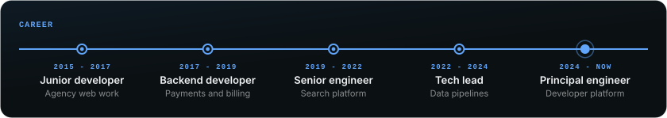 | `python skills/animated-svg/scripts/forge.py --kind timeline --data examples/data/career.json --out examples/timeline-career.svg` |
| timeline | short<br>vertical rail, one-shot, light theme |  | `python skills/animated-svg/scripts/forge.py --kind timeline --variant vertical --timing short --theme light --accent '#0ea5e9' --data examples/data/career.json --out examples/timeline-vertical.svg` |
| logos | short<br>inline SVG symbols, a PNG and text pills |  | `python skills/animated-svg/scripts/forge.py --kind logos --data examples/data/logos.json --out examples/logos-wall.svg` |
| logos | ambient<br>slow marquee at 24 px/s |  | `python skills/animated-svg/scripts/forge.py --kind logos --timing ambient --speed 24 --data examples/data/logos.json --out examples/logos-marquee.svg` |
| calendar | short<br>quartile levels: one 140-count day does not flatten the rest |  | `python skills/animated-svg/scripts/forge.py --kind calendar --data examples/data/contributions.json --out examples/calendar-green.svg` |
| calendar | medium<br>accent ramp from start and counts, looping reveal | 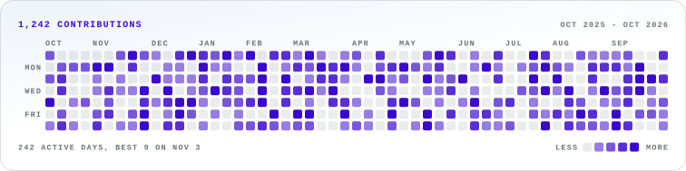 | `python skills/animated-svg/scripts/forge.py --kind calendar --variant accent --accent '#a78bfa' --theme light --timing medium --data examples/data/activity.json --out examples/calendar-accent.svg` |
| ring | short<br>both themes, value/max labels and tones |   | `python skills/animated-svg/scripts/forge.py --kind ring --theme both --data examples/data/goals.json --out examples/ring-goals.svg` |
| ring | medium<br>fixed 480x360 canvas wraps the rings into rows | 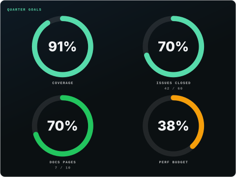 | `python skills/animated-svg/scripts/forge.py --kind ring --timing medium --accent '#34d399' --width 480 --height 360 --data examples/data/goals.json --out examples/ring-loop.svg` |
| flow | long<br>text spec file: parallel steps, edge labels, a return arc |  | `python skills/animated-svg/scripts/forge.py --kind flow --timing long --data examples/data/pipeline.txt --out examples/flow-text.svg` |
| flow | medium<br>inline text spec |  | `python skills/animated-svg/scripts/forge.py --kind flow --data 'push -> build -> unit, e2e -> deploy' --out examples/flow-text-inline.svg` |

Files made with `--theme both` come as a `-dark` and `-light` pair; forge.py prints
the `<picture>` snippet that switches between them on GitHub:

```html
<picture>
  <source media="(prefers-color-scheme: dark)" srcset="examples/hero-violet-dark.svg">
  <source media="(prefers-color-scheme: light)" srcset="examples/hero-violet-light.svg">
  
</picture>
```
